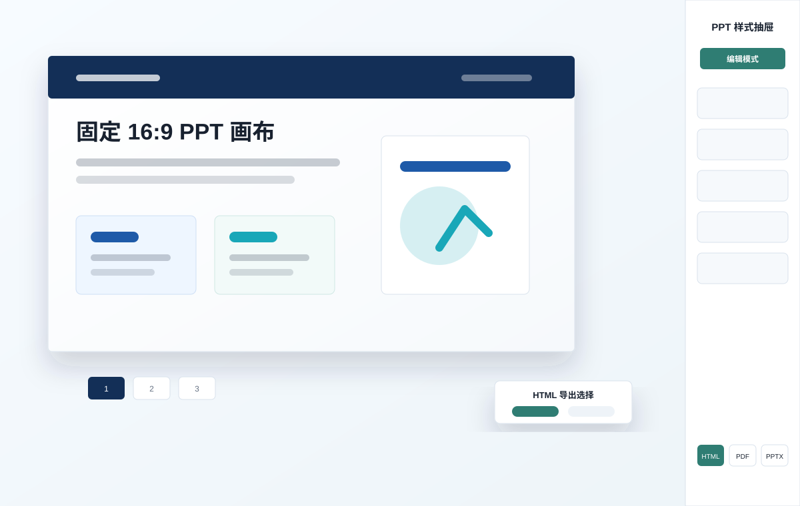

# HTML Report

## Purpose

Provide a content-neutral HTML report foundation. The calling skill, existing report, model, or user owns the topic, outline, copy, page count, colors, charts, images, and analysis. Template demo content is disposable and must never be treated as recommended report content or visual direction.

## Confirm The Mode First

Every new report must explicitly use one mode:

- `single-page`: one vertically scrolling, fluid HTML report. It supports editing, standalone HTML export, and click-triggered long PNG / one-page long PDF export through the local preview service.
- `ppt`: a slide deck with a fixed `1440 × 810` canvas, navigation, optional adaptive browsing, `html-pptx-data`, and click-triggered PNG/PDF/PPTX export through the local preview service. The PNG button exports one image per `.slide`; the PDF button exports the current edited browser snapshot, with each `.slide` captured as one PDF page. Adaptive browsing must reflow narrow viewports without horizontal overflow or covering the right-side slide navigation.

If the calling skill or model already declares the mode, use it. Otherwise ask the calling skill or user before generating files. Do not infer or default the mode.

## Shared Editing Contract

Both modes must keep:

- a compact bottom-right gear and right-side drawer; drawer width is `320px` and the label column stays compact so inputs remain usable;
- drawer control groups as collapsed accordion sections by default, with one visible section open at a time; both modes use task-oriented common groups named `浏览与模式`, `全局样式`, `对象编辑`, and `图表数据`; PPT mode also includes `表格设置`; both modes include a visually distinct fixed `修复识别` repair group above the `导出` footer;
- each drawer group must include a short help sentence that explains when to use it;
- an explicit edit-mode toggle;
- global font family, body line-height, and table padding controls; the font-family control is a multiline textarea so long fallback stacks are editable. Neither mode provides global metric/body/note size controls: adjust text size only through the selected element’s independent font-size control. Headings retain their source sizes until that per-element control changes them. Use direct numeric inputs without `min`/`max`, not sliders;
- neither edit mode shows typography-level badges or corner labels;
- before editing or opening the drawer, refresh the global layout inputs available in the active mode from the currently rendered page values; changing one must not alter any heading size;
- metric values such as `.metric .value`, `.metric strong`, or `[data-ppt-level="metric"]` retain their source styles; labels and descriptions inside metric cards remain body text;
- direct text editing only while edit mode is enabled;
- per-element selection and independent inline styles;
- in edit mode, an editable `<label for="…">` selects the label itself instead of forwarding its click to the associated field; outside edit mode, retain the field's native label-focus behavior;
- `表格设置` and `图表数据` are separate context-aware groups: table controls are disabled until a table column/cell is selected or a table is manually recognized, while chart controls are disabled until an ECharts chart is selected or manually recognized; neither group is available while editing ordinary text, shape, or image elements;
- color controls pair the native color swatch with a HEX text field that accepts pasted `#RGB` or `#RRGGBB` values;
- a selected-element panel with a delete command, plus lightweight reset commands for global typography, dimensions, text styles, and box styles;
- automatically recognize report content at initialization and when content is added: semantic text and leaf text containers, card/panel-like shapes, real images, ECharts/chart containers, and real tables. Keep the manual recognition module in both modes as a repair path for ambiguous content, in the fixed repair area rather than mixed into common drawer controls;
- recognizable icons for every drawer module;
- a compact, low-contrast footer line at the bottom with the GitHub project link `https://github.com/Lucas-Fong/html-report-stable-base`, author `Lucas Fong`, `MIT License`, and `© 2026`, without repeating the same author/copyright text;
- ECharts canvas rendering when supplied content includes charts.

Mark independently editable elements with exactly one type:

```html
<h2 class="editable" data-editable-element="text">Title</h2>
<div data-editable-element="shape">Card</div>
<div class="chart" data-editable-element="chart"></div>

```

Supported independent controls:

| Type | Controls |
|---|---|
| `text` | width, height, font size, color, weight, alignment, line-height, background, border color/width, radius |
| `shape` | width, height, fill, border color/width, radius |
| `chart` | width and height; call the ECharts instance `resize()` after changes; ECharts data JSON editor for `categories` / `series` and advanced `{ "option": {...} }` updates |
| `image` | width and height; after choosing a local replacement for the selected real ``, open a crop step whose frame matches the image's rendered aspect ratio; apply the cropped result as an inline data URL while preserving the target's object-fit/aspect behavior in standalone HTML and exports |

Only one element may be selected. Independent styles are written inline and override global variables only for that element. Width edits must work for inline text, flex children, and elements constrained by `max-width`; the editor may set `display:inline-block`, a matching flex basis, and `max-width:none` on the selected element. Do not add free dragging or absolute-position controls.

Read `references/drawer-contract.md` when creating or adapting a template.

When adapting an existing HTML report and the user asks to preserve the style, also read `references/existing-html-adaptation.md` before generating the model.

## Model Contract

Use `scripts/build_html_report_from_model.py`. The top-level `mode` is required.

For `ppt`, keep the existing `slides` model and structured `objects`:

```json
{"mode":"ppt","title":"Deck","slides":[{"title":"Page 1","html":"...","objects":[]}]}
```

For `single-page`, use sections without PPTX objects. A section may optionally provide `chapter`; adjacent sections with the same chapter render as one visibly separated navigation group:

```json
{"mode":"single-page","title":"Report","sections":[{"id":"overview","chapter":"Executive view","title":"Overview","html":"..."}]}
```

Each single-page section may include optional `id`, `title`, `chapter`, and `class`; `html` is required. The builder must reject a missing or invalid mode rather than choosing one.

## Bundled Asset Skills

The plugin distribution also bundles two independent helper skills under `skills/`:

- `skills/echarts-charts`: use when supplied report data needs a standalone ECharts HTML chart, an ECharts `option`, or an embeddable chart asset.
- `skills/generate-word-clouds`: use when supplied keyword/weight data needs one or more horizontal PNG word clouds.

When a report needs these assets, read the bundled helper skill first and resolve its `scripts/` and `references/` paths relative to that helper skill directory. Insert generated chart HTML/options or PNG files into the HTML report model only after the helper output exists.

For a fresh environment, run `node <skill-root>/scripts/bootstrap_html_report_deps.mjs` before browser export, browser QA, PPTX export, or word-cloud generation if Node/Python dependencies or Chromium are missing. The bootstrap installs Node dependencies, creates `<skill-root>/.venv` for Python dependencies, and installs Playwright Chromium for this plugin. If the system `python` lacks dependencies after bootstrapping, use `<skill-root>/.venv/bin/python` for Python commands.

## Visual Examples

Use these visuals as orientation for authors who are applying the skill to new content or adapting an existing report. They are examples of the shell and interaction pattern only; do not copy their dummy content into a report.

### Single-Page Report


Use this pattern when the output should read as a long, vertically scrolling report: a hero or opening section, repeated content sections, optional side section navigation, and a right-side style drawer. Keep the report in normal document flow and let section height expand with the content.

Minimal model:

```json
{
  "mode": "single-page",
  "title": "Market Audit",
  "sections": [
    {
      "id": "summary",
      "title": "Executive Summary",
      "html": "<h1 class=\"editable\" data-editable-element=\"text\">Executive Summary</h1><p class=\"editable\" data-editable-element=\"text\">...</p>"
    }
  ]
}
```

### PPT Report



Use this pattern when the output must behave like a slide deck: fixed `1440 × 810` pages, page navigation, stable object geometry, and editable PPTX export. Keep page furniture fixed and non-editable, while report objects are represented in both DOM and `html-pptx-data`.

Minimal model:

```json
{
  "mode": "ppt",
  "title": "Strategy Deck",
  "slides": [
    {
      "title": "Page 1",
      "html": "<h1 class=\"editable\" data-editable-element=\"text\">Page 1</h1>",
      "objects": []
    }
  ]
}
```

### Adding GIFs Or Screenshots

If a future update adds a workflow GIF or screenshot, store it in `assets/examples/` and reference it from this section with relative Markdown paths. Keep media small enough for GitHub review. Prefer short GIFs that show one interaction only, such as opening the drawer, selecting an element, changing a HEX color, or exporting HTML.

## Mode-Specific Rules

### Single-Page

- Use `assets/template/html-report-single-base.html`.
- Use normal document flow, full available page width, and auto height. Do not add slide snapping, PPT slide navigation, page numbers, a fixed content max-width, or a fixed 16:9 canvas.
- Provide single-page section navigation from `.report-section[data-title]` in five modes—`hidden`, `top`, `embedded`, `floating`, and `dots`—plus independent `left` / `right` position controls; default to `top` + `left`. Top mode is fixed to the page top and aligns its menu to the chosen side; embedded modes reserve a left or right column and can be collapsed; floating modes may overlay report content; dot modes show only compact section dots, not title text. Right-side top and embedded navigation must avoid the open right drawer.
- Keep the navigation deliberately compact: embedded width `156px` (collapsed `40px`), floating width `112px`, and dot targets `18px`. Render a simple first-level menu with one ordinary link per optional `data-chapter` (falling back to numbered chapters), never a second-level section tree. Labels contain at most five Unicode characters and retain the full chapter title in the link `title` attribute.
- Edit mode must not show typography-level badges or corner labels in either mode. Text remains editable and its size is adjusted from the selected element’s controls; metric labels and descriptions remain body text, while only metric values use the metric source styles.
- Keep `HTML / 图片 / PDF` export buttons. Every export action, including standalone HTML, is available only through the local preview-service URL; when the report is opened as `file://`, explain this in the drawer and block the action instead of using a browser fallback. HTML uses the `保留编辑` / `仅查看` modal only after this check. 图片与 PDF 必须由用户点击后通过本地预览服务即时生成，不得在生成阶段预产出。Do not include PPTX, `html-pptx-data`, `data-pptx-name`, or PPT geometry sync.
- Editable delivery HTML retains all user edits, selected section navigation style, inline local CSS/JS/images/data, and the closed editor drawer/gear. View-only delivery HTML hides editor controls but retains navigation; PPT view-only files must still switch between PPT and adaptive browsing.
- Before serializing editable HTML, restore runtime-generated accordion controls to their source headings so initialization can attach fresh click handlers when the standalone file is reopened.
- Preserve the active PPT/adaptive browsing state in standalone PPT HTML and initialize the mode toggle and label from that state.
- In edit mode, `浏览与模式` must expose `#currentPageVisible` for the section currently in view and `#restoreHiddenPages`. Hidden sections are removed from section navigation and every export snapshot; never allow all sections to be hidden.
- Name browser-downloaded HTML from the first visible report section's H1. Sanitize filesystem-invalid characters, cap the stem at 72 Unicode characters, and fall back to `document.title` / `html-report` when no cover H1 is available.
- Long PNG/PDF exports must be generated from Chromium's native `#report` screenshot path, not SVG `foreignObject`, so they match the browser rendering and avoid print truncation.

### PPT

- Use `assets/template/html-report-ppt-base.html`.
- Keep the fixed `1440 × 810` canvas, equal left/right margins, page navigation, PPT/adaptive browsing, table column controls, and geometry scaling.
- In adaptive mode, narrow layouts (including a `744 × 756` viewport) wrap long text, reflow grids, reserve room for the right-side slide navigation, and keep every visible slide within the viewport width.
- The PPT/adaptive toggle uses a compact presentation-canvas icon, not a Unicode box-character icon.
- Keep `html-pptx-data`, unique per-slide object names, DOM-to-JSON synchronization, and editable PPTX export.
- When the user provides a visual reference, or explicitly requests high fidelity, reconstruction, replication, or an editable PPTX, read [references/native-pptx-fidelity-standard.md](references/native-pptx-fidelity-standard.md) before authoring the PPTX export. Treat that route as the default for the request; do not weaken it to image-based slides.
- Keep `HTML / 图片 / PDF / PPTX` export buttons. Every export action, including standalone HTML, is available only through the local preview-service URL; when the report is opened as `file://`, explain this in the drawer and block the action instead of using a browser fallback. HTML shows `保留编辑` / `仅查看` only after this check; PNG, PDF and PPTX are generated only after the user clicks them in the local preview service. Export clicks must first synchronize DOM edits into `html-pptx-data`, submit the current `documentElement` snapshot to `/api/export`, and write outputs into `<output>/exports/`; PNG output must contain exactly one `1440×810` image per `.slide`, while PDF output must contain exactly one page per `.slide`. Before a PNG or PDF capture, wait until every document image has completed loading and has non-zero natural dimensions. If any image fails, return a clear export error and do not write a blank output file.
- Editable PPTX is the default PPT-mode export contract: synchronize only when the user requests PPTX, then convert standard DOM objects to native PowerPoint objects. For `pptxContractVersion: 2`, the preview service calls `scripts/export_native_pptx.mjs` only on that export request; the exporter uses `@oai/artifact-tool` and must write text through the PowerPoint `typeface` field. Text must receive explicit point-size/line-height/wrap settings; footer, kicker, and page-number text must use fixed 12pt metrics and stable single-line frames; HTML tables must be native PowerPoint tables with horizontal and vertical center alignment; SVG/data images must be embedded as raster media. Map ordinary ECharts `bar`/`column`/`line`/`pie` series from either `data-chart-data` or `data-chart-option` into native editable chart data. Do not require a report-specific script for these mappings. For visual-critical text only, a model object may provide `nativeFrame`, `nativeText`, or `nativeTextStyle`; these values override its DOM-measured counterpart only during PPTX export, so the browser report stays fast while a native deck can pin exact line breaks, colors, baselines, and Microsoft YaHei metrics.
- Keep normal browser editing lightweight. Browser geometry synchronization, chart normalization, image rasterization, PPTX construction, and export verification run only after the PPTX export action or an explicit export command. Complex ECharts types that PowerPoint cannot represent natively (for example maps, gauges, radar, custom series) require a declared image fallback or a report-specific editable mapping; never silently claim that they are editable.
- Page furniture such as kickers, footers, and page numbers remains fixed, non-editable, and `12px`/`12pt`.
- Editable standalone HTML export preserves edits and charts while keeping the editor entry point; view-only export hides the drawer and gear but keeps report navigation and a PPT/adaptive browse-mode toggle.
- In edit mode, `浏览与模式` must expose `#currentPageVisible` and `#restoreHiddenPages`. A hidden page is unavailable from normal navigation and all export snapshots (HTML/PNG/PDF/PPTX); remaining visible `.page-number` footers are renumbered from `01` without gaps. Keep at least one page visible. While editing, hidden pages may remain reachable only so the author can restore them.
- Name browser-downloaded HTML from the first visible cover H1 using the same sanitized, 72-Unicode-character filename rule as single-page mode.

## Workflow

1. Require a supplied content source; do not invent report content.
2. Confirm `single-page` or `ppt` before generation.
3. Build from the matching template and model, or preserve an existing report while adding the matching shell. For existing HTML, use the adaptation fast path reference first.
4. Add `.editable` to text content and `data-editable-element` to independently styled elements.
5. Use real `<table>` markup for every table-like matrix/list comparison. Style it to look like a card or divider-only pseudo table when desired, but do not use div-only pseudo tables for editable table content.
6. In PPT mode, keep visible objects and `html-pptx-data` synchronized with `data-pptx-name`; exclude hidden pages from snapshot/export JSON and renumber visible footer page numbers.
7. If any important content may have been missed, use the drawer's `补充识别` module in either mode: click `选择页面元素`, click the page element, then mark it as `文本` / `矩形` / `图表` / `图片` / `表格`.
8. If dependencies are missing in a newly installed environment, bootstrap them once:

   ```bash
   node <skill-root>/scripts/bootstrap_html_report_deps.mjs
   ```

9. Run the mode-aware static checker:

   ```bash
   python <skill-root>/scripts/check_html_report.py <output>/index.html
   ```

10. Run browser QA when Playwright is available and the change affects layout, editing, export controls, charts, or browser behavior:

   ```bash
   node <skill-root>/scripts/qa_html_report.mjs <output>/index.html
   ```

11. Run the editable-base acceptance check when the change touches the editor shell, drawer controls, element styling, chart/table editing, or PPT export layout. It covers drawer icons, edit/save labels, L-level controls, reset, delete, constrained element dimensions, manual recognition, ECharts data editing, and PPT export layout:

   ```bash
   node <skill-root>/scripts/qa_editor_enhancements.mjs <output>/index.html
   ```

   When the PPT template or PPTX exporter changes, also run the default editable-PPTX regression. It uses a plain PPT model without custom export JavaScript and verifies native text, table, simple ECharts chart, SVG image, and footer/page-number output:

   ```bash
   python <skill-root>/scripts/test_default_pptx_fidelity.py
   ```

   For high-fidelity native exports, also read `references/native-pptx-fidelity-standard.md`; render the final PPTX page by page, compare it with the supplied reference or browser source, and run the slide overflow check before delivery. Do not run this visual rendering loop during ordinary HTML generation.

12. To enable high-fidelity click-triggered exports, start the local preview service from a directory that contains `index.html`, and return its URL:

   For a PPT v2 report that may export the native editable PPTX, call `load_workspace_dependencies` first. Pass its `RUNTIME_NODE`, `RUNTIME_NODE_MODULES`, and `RUNTIME_BIN_DIR` values to this preview-service process. HTML generation, browsing, and PNG/PDF export do not require these values; a PPTX click validates them at export time and returns a clear error when they are absent.

   ```bash
   node <skill-root>/scripts/start_html_report_preview.mjs <output> 5300
   ```

   The service binds only to `127.0.0.1`. It writes PDF/PNG/PPTX outputs after user action into `<output>/exports/`; it never pre-generates exports or rewrites `<output>/index.html`. If the port is busy, retry with the next nearby free port rather than stopping.

13. Run the preview export acceptance check when changing export buttons, the preview service, snapshot cleanup, PDF/PNG/PPTX output, or before releasing the skill:

   ```bash
   node <skill-root>/scripts/qa_preview_export.mjs <output>/index.html
   ```

   This is intentionally heavier than the static checker because it starts the preview service and exercises Chromium-backed exports. Do not run it as a default generation step for every ordinary report unless export behavior changed or the user needs immediate export verification.

   The acceptance check must also prove that a snapshot with a missing local image is rejected instead of producing a blank PNG or PDF.

14. Return `<output>/index.html` by default. Export standalone HTML only when requested:

   ```bash
   python <skill-root>/scripts/export_html_report.py <output>/index.html --out-dir <output>/exports --formats html --html-mode editable
   ```

   `editable` is the default and preserves the editor entry point. Use `--html-mode view` for read-only HTML; PPT view-only HTML still permits PPT/adaptive browsing. PPT mode may additionally request PDF/PPTX; PNG export remains a click-triggered preview-service action.

15. For scripted, non-interactive single-page long image/PDF exports only, use Chromium screenshot export:

   ```bash
   node <skill-root>/scripts/export_single_page_long.mjs <output>/index.html <output>/exports
   ```

   This produces `<output>/exports/index-long.png` and `<output>/exports/index-long.pdf`; it is not the default UI flow.

## Performance Notes

HTML generation is usually fast; slow runs come from verification/export stages rather than the model builder. The common causes are:

- repeated Chromium startup in Playwright QA or export scripts;
- PPT PDF export screenshotting each slide at high device scale;
- PPTX export synchronizing DOM geometry through a browser before writing structured slides;
- standalone HTML export inlining large local scripts, charts, images, or data assets;
- running `qa_html_report.mjs`, `qa_editor_enhancements.mjs`, and `qa_preview_export.mjs` serially for every report.

普通内容生成默认只运行静态检查。仅在模板、编辑器、导出或视觉合同变更时运行浏览器验收。Default report delivery should run the static checker and only the browser checks that match the changed surface. Start `start_html_report_preview.mjs` for user-facing preview/export, because the service keeps Chromium warm for click-triggered PNG/PDF exports and reuses the submitted `html-pptx-data` for PPTX instead of launching another browser sync. Use `qa_preview_export.mjs` for release/export changes, not as a mandatory generation-time pre-export.

## Quality Gate

Block delivery when any applicable check fails:

- mode is missing or conflicts with the template;
- the drawer, edit toggle, global controls, or four element protocols are unavailable;
- drawer control groups are not collapsed by default or allow multiple visible sections to remain open;
- independent edits affect unselected elements;
- chart dimensions change without an ECharts resize;
- ECharts data edits do not call `setOption()`, do not persist edited data on the chart element, or are lost by standalone HTML export;
- single-page output lacks full-width flowing layout, section navigation controls, chapter groups, any supported navigation style, compact embedded/floating/dot navigation, has labels longer than five Unicode characters, or contains PPT navigation, PPTX controls, or PPTX JSON;
- either edit mode renders typography-level badges or corner labels, exposes global metric/body/note font-size controls, or metric labels/descriptions follow metric sizing instead of body sizing;
- a drawer module lacks its icon, reset/delete behavior is unavailable, edit mode does not use `编辑模式` / `保存修改`, closing the drawer while editing does not first save/exit edit mode, global typography inputs do not start from the page's computed sizes, or constrained inline/flex/max-width element dimensions cannot be changed;
- adaptive PPT browsing overflows horizontally or slide content overlaps the right-side navigation at the `744 × 756` acceptance viewport;
- either mode lacks the task-oriented drawer groups, group help text, or the GitHub/author/license/copyright footer information;
- a selected image lacks a local-file replacement and crop path, its crop frame does not match the rendered image ratio, replacement changes a different image or its display geometry, or the cropped replacement is not retained in standalone HTML / PPT DOM synchronization;
- the current-page visibility control is unavailable in edit mode, all pages can be hidden, a hidden page remains in navigation or an export snapshot, PPT visible footer page numbers do not renumber consecutively, or downloaded HTML does not use the visible cover title as a safe filename;
- the drawer is wider than `320px`, global controls use a slider or bounded numeric input, the PPT/adaptive toggle lacks its presentation icon, export buttons do not match their mode, either mode's HTML export lacks its modal editability choice, PPT PDF export does not submit the updated browser snapshot, PPT PDF output does not contain one page per slide, or preview-service exports do not reflect the submitted page snapshot;
- a PNG or PDF export writes an image while any source `` has failed to load or has zero natural dimensions;
- color controls lack a pasted HEX path, or a valid HEX value fails to update only the selected element;
- an export action is available from a `file://` report, lacks a local-preview-service hint, or uses browser print / direct download as an offline fallback;
- automatic recognition does not cover semantic text, cards/panels, real images, chart containers, or real table cells; the `补充识别` module is unavailable in either mode, cannot mark unrecognized text as editable text, or cannot mark a real table's cells as editable;
- PPT output loses its canvas, navigation, JSON contract, or object uniqueness;
- a standard PPT text/table/image or supported simple ECharts bar/column/line/pie chart requires a report-specific export script, PPTX text lacks explicit metrics/wrapping, footer/page-number text wraps, a native PPT table is not centered in both axes, or a supported simple chart falls back to `图表未嵌入`;
- a requested high-fidelity PPTX uses whole-slide screenshots, falls back to a browser-default font, loses a reference color/critical title line break, skips page-by-page rendered comparison, or builds/renders PPTX before the user requests export;
- editable standalone HTML loses edits/assets/section navigation state, editor controls, or drawer accordion interactions after reload; view-only standalone HTML exposes editing controls or cannot switch browse mode; either export writes visible `\n` or keeps content after `</html>`.

## Resource Map

- `assets/template/html-report-single-base.html`: long-screen report shell.
- `assets/template/html-report-ppt-base.html`: editable 16:9 PPT shell.
- `assets/template/shared/report-editor.css` and `report-editor.js`: shared global and per-element editor.
- `scripts/build_html_report_from_model.py`: explicit-mode model builder.
- `scripts/check_html_report.py`: mode-aware static checks.
- `scripts/qa_html_report.mjs`: mode-aware browser QA.
- `scripts/qa_editor_enhancements.mjs`: editable-base browser acceptance QA.
- `fixtures/editor-contract-ppt.json` and `fixtures/editor-contract-single.json`: clean generation fixtures for editor acceptance.
- `scripts/export_html_report.py`: standalone HTML and PPT-mode PDF/PPTX export.
- `scripts/export_single_page_long.mjs`: single-page Chromium-rendered long PNG and one-page long PDF export.
- `scripts/start_html_report_preview.mjs`: localhost-only preview and click-triggered PNG/PDF/PPTX export service.
- `scripts/bootstrap_html_report_deps.mjs`: installs plugin Node/Python dependencies and Playwright Chromium when a new environment lacks them.
- `scripts/qa_preview_export.mjs`: local preview export and HTML export-choice acceptance QA.
- `fixtures/default-pptx-fidelity.json` and `scripts/test_default_pptx_fidelity.py`: no-custom-script regression for default editable PPTX fidelity.
- `requirements.txt`: Python dependencies for PPTX export, browser export, Excel extraction, and image handling.
- `skills/echarts-charts`: bundled ECharts helper skill with its own scripts and references.
- `skills/generate-word-clouds`: bundled word-cloud helper skill with its own scripts and references.
- `references/drawer-contract.md`: shared drawer and selection protocol.
- `references/existing-html-adaptation.md`: fast path for wrapping an existing styled HTML report without redesigning it.
- `references/native-pptx-fidelity-standard.md`: export-only native reconstruction and visual QA contract for high-fidelity editable PPTX work.
